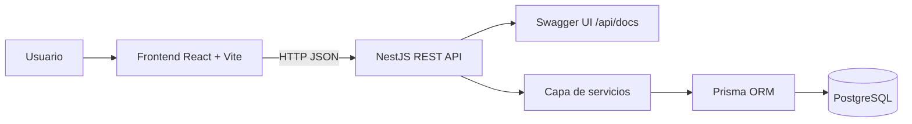
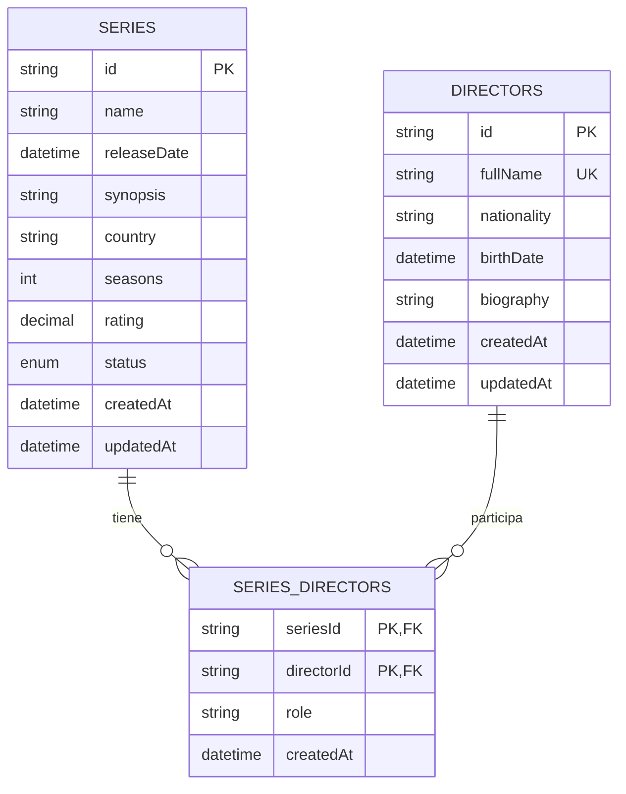

# OATI - Gestión de Series de Televisión y Directores

Solución del **punto #5** de la prueba técnica profesional: registrar series de televisión, registrar directores, asociarlos en una relación muchos a muchos, listar series con directores, consultar todas las series de un director, modificar y eliminar series/directores.

## 1. Stack tecnológico

| Capa | Tecnología | Motivo |
| --- | --- | --- |
| Frontend | React + Vite + TypeScript | Cliente web ligero, rápido y fácil de desplegar en Vercel. |
| Backend | NestJS + TypeScript | API REST modular, validaciones, controladores, servicios y Swagger. |
| Persistencia | PostgreSQL | Modelo relacional coherente para relación muchos a muchos. |
| ORM | Prisma | Modelo de datos declarativo, tipado y fácil de mantener. |
| Documentación API | Swagger/OpenAPI | Permite probar endpoints desde `/api/docs`. |
| Contenedores | Docker Compose | Levanta PostgreSQL local sin instalarlo manualmente. |

## 2. Reglas de negocio cubiertas

- Registrar información básica de series: nombre, fecha de lanzamiento, sinopsis, país, temporadas, calificación y estado.
- Registrar información básica de directores: nombre, nacionalidad, fecha de nacimiento y biografía.
- Una serie puede tener varios directores.
- Un director puede participar en muchas series.
- Listar series con su información y directores asociados.
- Listar todas las series en las que ha participado un director.
- Modificar y eliminar información de series y directores.
- Persistencia en PostgreSQL.
- API REST con operaciones CRUD y manejo de excepciones.
- Frontend web para consulta, registro, edición y eliminación.

## 3. Arquitectura



La aplicación separa responsabilidades en capas:

- **Controladores:** exponen endpoints REST.
- **DTOs:** validan y documentan los datos de entrada.
- **Servicios:** contienen la lógica de negocio.
- **Prisma:** administra la persistencia.
- **Frontend:** consume la API y permite operar la información desde una interfaz web.

## 4. Modelo de datos



La tabla intermedia `series_directors` permite representar correctamente la relación muchos a muchos entre series y directores.

## 5. Estructura del proyecto

```text
oati-series-directors/
├── backend/
│   ├── prisma/
│   │   ├── schema.prisma
│   │   └── seed.ts
│   └── src/
│       ├── common/
│       ├── directors/
│       ├── series/
│       ├── app.module.ts
│       └── main.ts
├── frontend/
│   ├── src/
│   │   ├── api/
│   │   ├── App.tsx
│   │   ├── styles.css
│   │   └── types.ts
├── docs/
│   ├── arquitectura.mmd
│   ├── modelo-datos.mmd
│   └── requests.http
├── docker-compose.yml
├── render.yaml
└── README.md
```

## 6. Ejecución local

### 6.1. Requisitos

- Node.js 20 o superior.
- Docker y Docker Compose.
- npm.

### 6.2. Levantar base de datos

```bash
docker compose up -d postgres
```

### 6.3. Configurar backend

```bash
cd backend
cp .env.example .env
npm install
npm run db:generate
npm run db:push
npm run db:seed
npm run start:dev
```

Backend disponible en:

- API: `http://localhost:3000/api/v1`
- Swagger: `http://localhost:3000/api/docs`
- Health check: `http://localhost:3000/api/v1/health`

### 6.4. Configurar frontend

En otra terminal:

```bash
cd frontend
cp .env.example .env
npm install
npm run dev
```

Frontend disponible en:

```text
http://localhost:5173
```

## 7. Endpoints principales

| Método | Endpoint | Descripción |
| --- | --- | --- |
| `GET` | `/api/v1/health` | Validar disponibilidad del servicio. |
| `POST` | `/api/v1/directors` | Crear director. |
| `GET` | `/api/v1/directors` | Listar directores con sus series. |
| `GET` | `/api/v1/directors/:id` | Consultar director por id. |
| `GET` | `/api/v1/directors/:id/series` | Consultar series asociadas a un director. |
| `PATCH` | `/api/v1/directors/:id` | Actualizar director. |
| `DELETE` | `/api/v1/directors/:id` | Eliminar director. |
| `POST` | `/api/v1/series` | Crear serie y asociar directores. |
| `GET` | `/api/v1/series` | Listar series con directores. |
| `GET` | `/api/v1/series/:id` | Consultar serie por id. |
| `PATCH` | `/api/v1/series/:id` | Actualizar serie y/o directores asociados. |
| `DELETE` | `/api/v1/series/:id` | Eliminar serie. |

## 8. Ejemplo de uso API

### Crear director

```bash
curl -X POST http://localhost:3000/api/v1/directors \
  -H "Content-Type: application/json" \
  -d '{
    "fullName": "Vince Gilligan",
    "nationality": "Estadounidense",
    "birthDate": "1967-02-10",
    "biography": "Creador y director de televisión."
  }'
```

### Crear serie

Reemplaza `DIRECTOR_ID` por el id retornado al crear/listar directores.

```bash
curl -X POST http://localhost:3000/api/v1/series \
  -H "Content-Type: application/json" \
  -d '{
    "name": "Breaking Bad",
    "releaseDate": "2008-01-20",
    "synopsis": "Drama criminal sobre un profesor de química.",
    "country": "Estados Unidos",
    "seasons": 5,
    "rating": 9.5,
    "status": "FINISHED",
    "directorIds": ["DIRECTOR_ID"]
  }'
```

## 9. Despliegue sugerido

### Backend en Render o Railway

1. Crear una base de datos PostgreSQL gratuita en Neon, Supabase, Railway o Render.
2. Crear un servicio web para la carpeta `backend`.
3. Configurar variables de entorno:
   - `DATABASE_URL`
   - `PORT=3000`
   - `CORS_ORIGIN=https://URL-DEL-FRONTEND`
4. Usar Dockerfile del backend o estos comandos:
   - Build: `npm install && npm run db:generate && npm run build`
   - Start: `npx prisma db push && npm run start`

### Frontend en Vercel

1. Importar el repositorio en Vercel.
2. Configurar la carpeta raíz como `frontend`.
3. Variable de entorno:
   - `VITE_API_URL=https://URL-DEL-BACKEND/api/v1`
4. Deploy.

## 10. Buenas prácticas implementadas

- Separación por módulos (`series`, `directors`, `common`).
- DTOs con validaciones usando `class-validator`.
- Manejo de errores de Prisma para duplicados y registros inexistentes.
- Relación muchos a muchos explícita con tabla intermedia.
- Prefijo versionado de API: `/api/v1`.
- Swagger para documentación y pruebas manuales.
- Docker Compose para base de datos local.
- Frontend con formularios de creación, edición, eliminación y consulta.
- `.gitignore`, `.env.example`, documentación y colección HTTP de pruebas.

## 11. Evidencia de funcionamiento sugerida para adjuntar

Cuando subas el proyecto al repositorio, agrega al README capturas o un GIF de:

1. Swagger cargando en `/api/docs`.
2. Creación de un director.
3. Creación de una serie seleccionando uno o varios directores.
4. Listado de series con sus directores.
5. Consulta de series por director.
6. Edición y eliminación desde el frontend.
